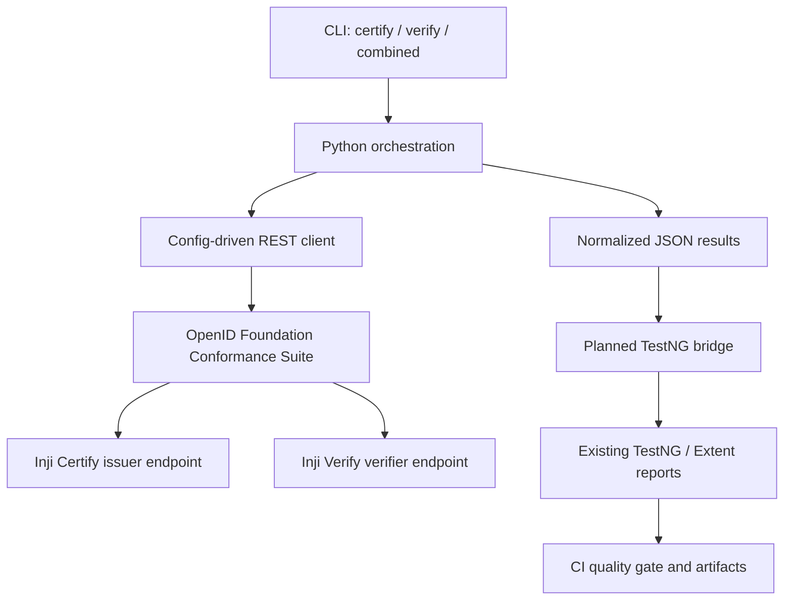

# MOSIP Inji OpenID Conformance Harness

Automates OpenID Foundation conformance-plan execution for **Inji Certify (issuer)** and **Inji Verify (verifier)**, with the intended destination being the existing MOSIP TestNG/Extent api-testrig reports.

> **Implementation status:** initial scaffold only. This branch contains a configurable HTTP client, normalized result model, CLI, sample configuration templates and starter unit tests. It does **not** yet execute real OpenID test plans. The route paths and payloads are deliberately blank until checked against the official API docs and the target Inji 1.0.x setup. Never treat mocked tests as real protocol conformance.

## Architecture



## Repository layout

- `conformance_harness/client.py` — standard-library HTTP client.
- `conformance_harness/runner.py` — orchestration/configuration validation.
- `conformance_harness/results.py` — normalized result structures.
- `conformance_harness/cli.py` — command-line entry point.
- `config/certify.json`, `config/verify.json` — **templates**; verify every URL, path and payload.
- `tests/` — starter unit tests.

## Requirements

- Python 3.10+
- pytest for tests (install with `python -m pip install -e ".[test]"`)
- Docker Compose and Java/Maven are needed for the planned full-stack/TestNG integration, not for the current Python unit tests.

## Run the starter tests

```bash
python -m pip install -e ".[test]"
pytest -q
```

## CLI

```bash
python -m conformance_harness.cli --component certify
python -m conformance_harness.cli --component verify
python -m conformance_harness.cli --combined
```

The CLI writes normalized JSON to stdout. To save it, add `--output reports/run.json`. Until real route mappings and lifecycle handling are implemented, a non-PASS result is expected and the command exits nonzero.

## Configuration

Each component JSON has:

- `conformance_base_url`: local conformance suite base URL.
- `sut_base_url`: the component endpoint; exact URL must be verified for your environment.
- `routes`: route method/path and payload definitions to be filled only from the official REST API documentation.
- `timeout_seconds`: request timeout.

Do not put secrets in committed JSON files. Use environment variables or local untracked files for any credentials.

## Implementation plan

1. Verify Docker Compose setup and actual service endpoints.
2. Confirm REST API request/response formats from the official documentation and upstream automation script.
3. Implement create/configure/start/poll/retrieve lifecycle using those verified formats.
4. Add real integration tests against a running local suite.
5. Bridge individual test outcomes to the existing Certify and Verify TestNG/Extent api-testrig.
6. Add CI execution and report artifacts.
7. Document any unsupported or unverified scenarios accurately.

## Upstream references

- [OpenID Conformance Suite REST API](https://www.certification.openid.net/api-document.html)
- [OpenID Conformance Suite repository and automation scripts](https://gitlab.com/openid/conformance-suite)
- [Inji Certify](https://github.com/inji/inji-certify)
- [Inji Verify](https://github.com/inji/inji-verify)
- [MOSIP functional tests](https://github.com/mosip/mosip-functional-tests)

## Known limitations

- No real test plan is executed by this initial scaffold.
- API routes, variants and payloads are not guessed.
- Docker Compose for the complete environment is not yet implemented.
- TestNG/Extent integration and CI conformance gate are pending.
